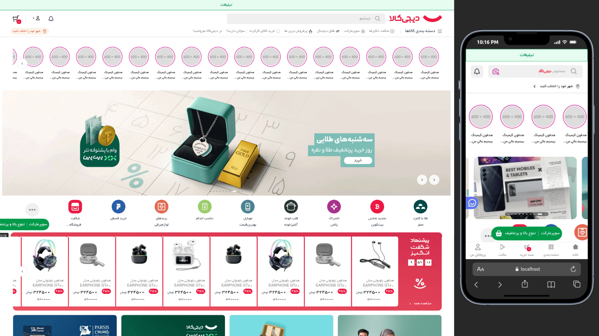
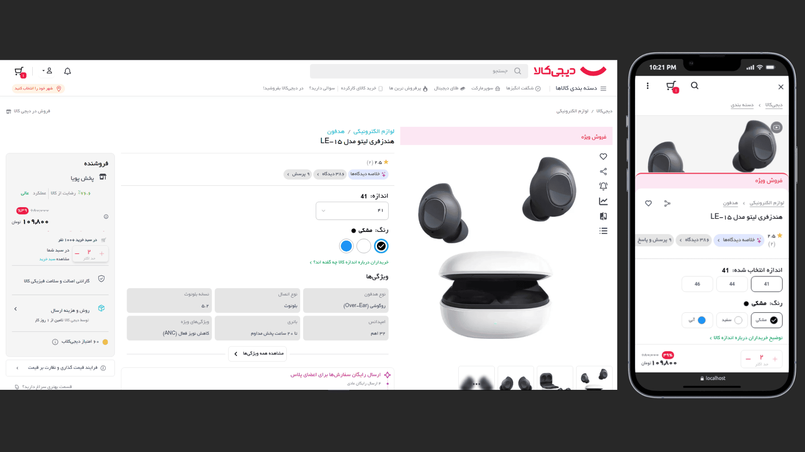
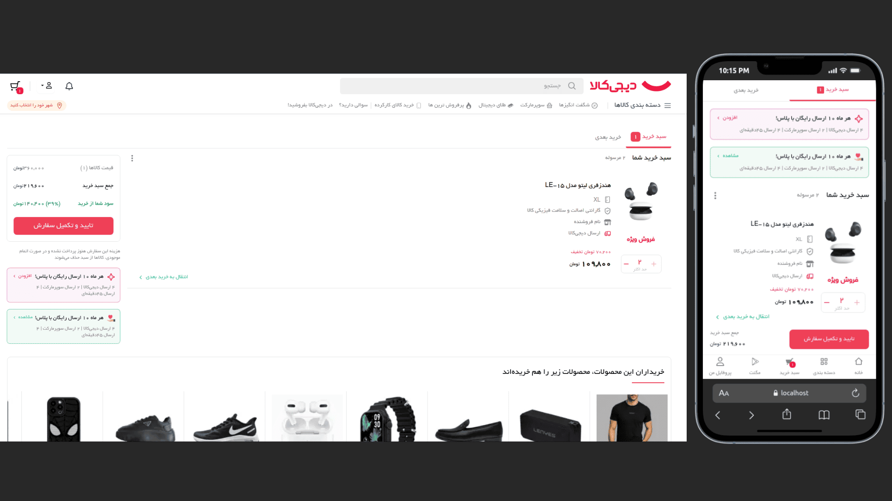
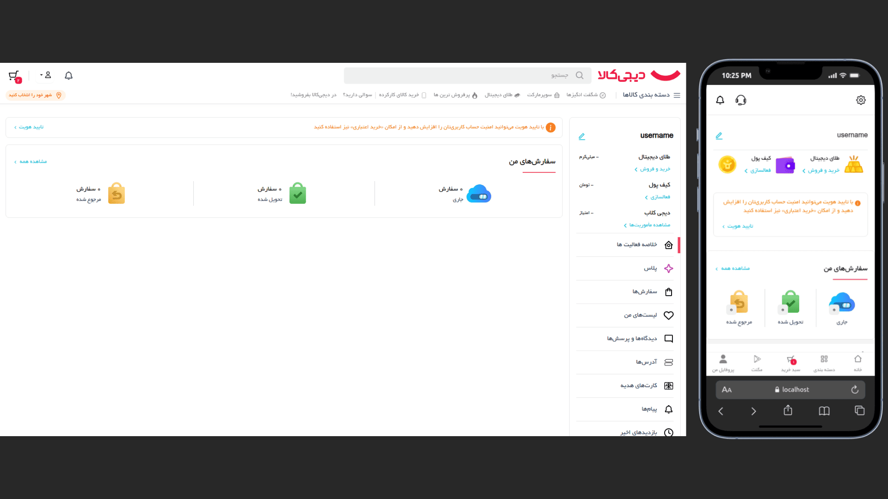
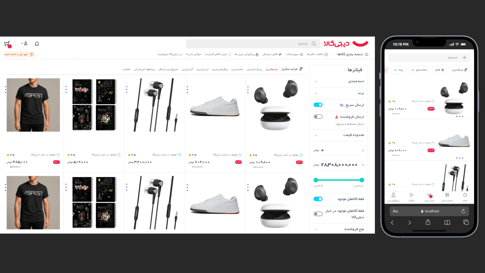
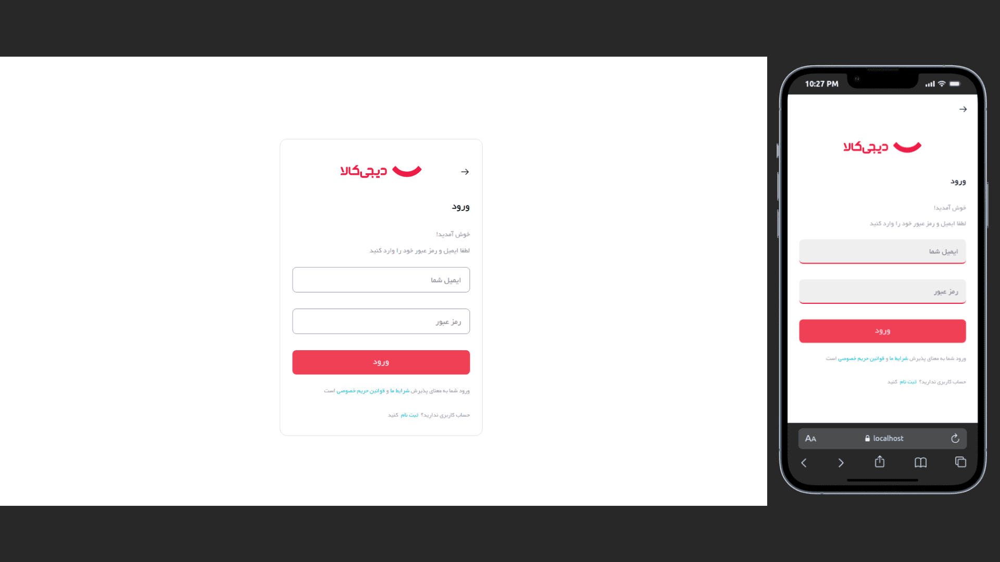

# Digikala Clone

A responsive e-commerce app built with **Next.js (App Router), TypeScript, Redux Toolkit, React Query and Appwrite**.
 
> **Live demo:** [digikala-clone-theta.vercel.app](https://digikala-clone-theta.vercel.app)
 
> **Disclaimer:** this is a non-commercial clone built for educational and portfolio purposes. It is not affiliated with or endorsed by Digikala or any other company.

---

## 📸 Preview
<a href="https://digikala-clone-theta.vercel.app/" target="_blank">
  
</a>

<a href="https://digikala-clone-theta.vercel.app/products/68bcb470002dabca68b8" target="_blank">
  
</a>


<details>
<summary>More Screenshots</summary>

### Cart Page
<a href="https://digikala-clone-theta.vercel.app/cart" target="_blank">
  
</a>


### Profile Page
<a href="https://digikala-clone-theta.vercel.app/profile" target="_blank">
  
</a>


### Search Page
<a href="https://digikala-clone-theta.vercel.app/search" target="_blank">
  
</a>

### Login Page
<a href="https://digikala-clone-theta.vercel.app/login" target="_blank">
  
</a>

</details>


## 📌 Implemented Parts

**Note:** All pages are responsive for both mobile & desktop screens.

### Header
- Navigation bar (+ hover tracker)  
- Search panel → searched term redirects to `/search?q=${searchTerm}`  
- Categories menu  
- Profile menu  
- Mini-cart  

### Footer

### Landing Page
- /
- Complete page UI (some extra functionalities pending)  

### Login / Signup Page (+ intercepting-route modal)
- login: /login
- signup: /signup
- Login & Signup functionalities  
- Saving users in **Appwrite Users**  
- Controlling auth via **Next.js Middleware** (for protected routes like `/profile`)  

### Profile Page

- /profile

### Product Page (`/products/[productId]`)
- Example: `/products/demo` or `/products/[productId]`  
- Valid `productId` → product fetched from Appwrite SDK using `getProduct` (cached with `React.cache()`)  
- Data fetched in both:
  - `generateMetadata()` → update page title  
  - `page` component → render UI  
- Invalid `productId` → **404 page**  
- Features:
  - Image carousel  
  - Image modal carousel (on click)  
  - Add to cart  
  - User comments (desktop + mobile)  
  - User questions (desktop + mobile)  
  - Product details & properties  
  - …and more  

### Search Page
- /search
- Infinite scrolling (React Query → Appwrite SDK)  
- Search by query params (`?q=searchTerm`)  
- Matches fetched and displayed dynamically  
- Clicking product → navigates to `/products/[productId]`  
- Filters:  
  - Controlled via `searchParams` in URL (set/remove filters)  
- Responsive products grid  

### Cart Page
- /cart
---

## 🛒 Cart System

- **Client-side cart:** items saved in Redux + localStorage  
- **Server-side cart:** each logged-in/registered user has a cart document in DB  
- Updates applied with **optimistic updates** (React Query + Appwrite API)  

### Cart States
1. **Guest:**  
   - Items saved in client (Redux + localStorage), persisted across sessions.  

2. **Login:**  
   - Guest cart items merged with server cart.  
   - Final items fetched from server → populate client cart.  
   - From here, any change (add/remove/update) updates both client & server.  

3. **Register:**  
   - New account → new server cart created.  
   - Client items synced into server cart.  
   - Server cart fetched → populates client cart.  
   - From here, any change updates both client & server.  

4. **Logout:**  
   - Client-side cart cleared.  
   - User returns to guest state.  

---

## 💬 Comments & Questions System

- Only **logged-in users** can post comments/questions/responses.  

### Comments
- User must select a **rating (1–5)** when commenting.  
- Average product rating calculated and shown.  

### Questions
- Each question supports multiple **responses**.  
- Responses appear nested under the question.  

### Reactions (Like / Dislike)
- Users can react to comments or question responses.  
- Managed with React Query + optimistic updates.  
- Possible actions:
  - **Create:** no reaction → like/dislike → `createDocument()`  
  - **Update:** change like ↔ dislike → `updateDocument()`  
  - **Delete:** repeat same action (like→like, dislike→dislike) → `deleteDocument()`  

---

## 🛠️ Tech Stack
- Next.js (React, App Router)  
- TypeScript  
- Redux (Redux Toolkit)  
- TailwindCSS  
- ShadCN UI  
- React Query  
- Appwrite  

<!-- ---

## 🧑‍💻 Skills
- Core e-commerce functionalities:
  - Login & Signup  
  - Protected routes (profile)  
  - Cart management  
  - Fetching products, comments, questions, cart items  
  - Posting comments/questions  
  - Search filters with URL params  
  - Viewing product details  
- Semantic HTML  
- UI animations & effects  
- Responsive design (desktop & mobile)  
- Reusable components  
- Global state management with Redux  
- CRUD operations with React Query  
- Type safety with TypeScript  
- Using Next.js advanced features:  
  - App Router  
  - Streaming  
  - Middleware  
  - Intercepting Routes  
  - Parallel Routes  
  - Loading pages   -->

---

## ✅ Functionalities
- Login / Sign-up  
- Fetching products  
- Searching products  
- Viewing product (with comments/questions)  
- Cart management (add, increase, decrease, remove items)  
- Posting comments/questions  

---

## ⚡ Next.js Features
- App Router  
- API Routes (Route Handlers)  
- Middleware (private/public routes by `isAuth`)  
- Intercepting Routes + Parallel Routes (Login/Signup modal)  
- Image optimization (`next/image`)  

---

## 🔑 Authentication

- Appwrite **email + password** authentication (no phone/SMS for privacy).  
- Appwrite configs for **server** and **client** included.  
- Related Appwrite API functions handle data.  
- **Appwrite Account API** manages client authentication.  

### Flow
- **Sign-up** → `/signup` → creates Appwrite user + DB user document  
- **Sign-in** → `/login`  
- **Sign-out**  

### Auth State in Redux (`authSlice`)
```ts
user: {
  id,
  name,
  username,
  email,
  imageUrl (avatar)
}
```

-   Session cookies managed via Route Handlers (API Routes).

-   Middleware checks `isAuth` for protected routes.


* * * * *

## 🖥️ How to View the Project


1. Clone & install:

    - npm install --force

    - npm run dev

    - Open <http://localhost:3000>

2. Or visit the live demo:
[Live Demo](https://digikala-clone-theta.vercel.app)